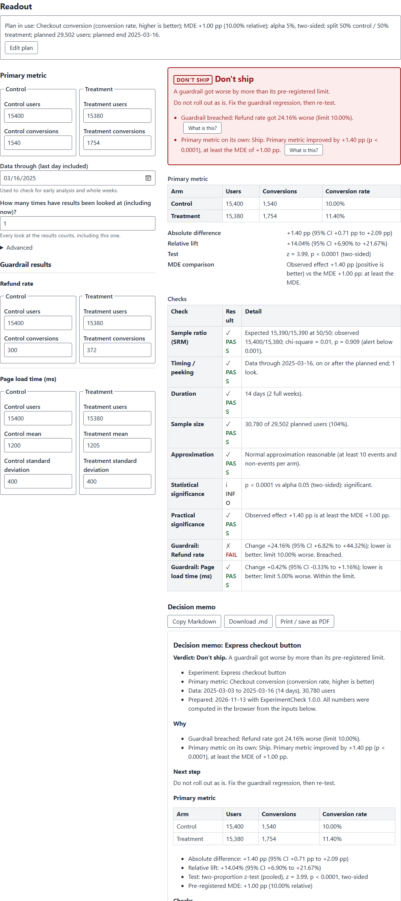
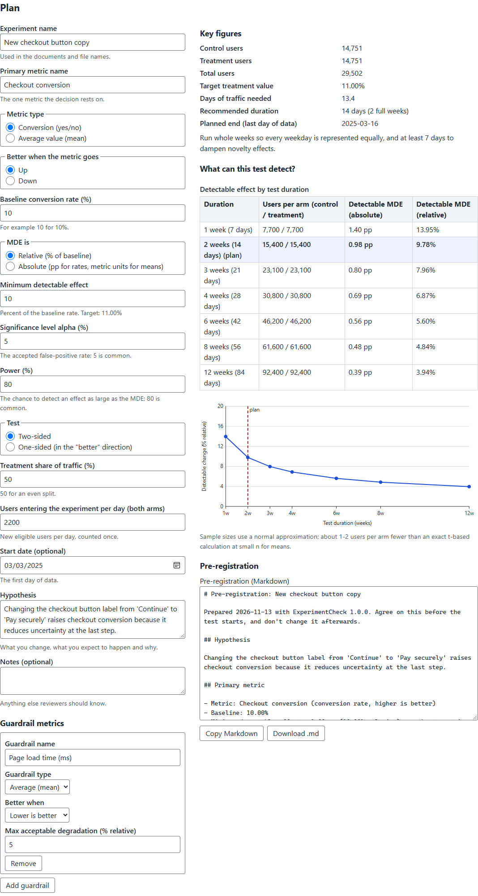
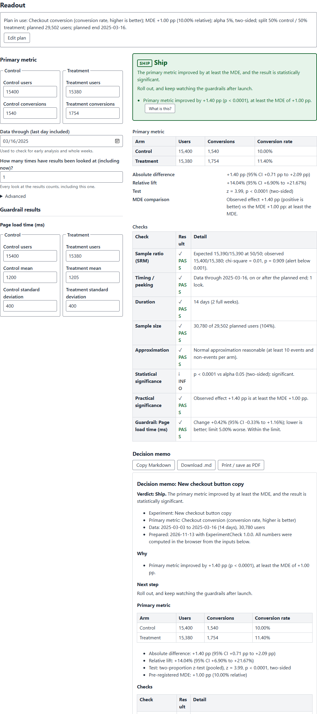
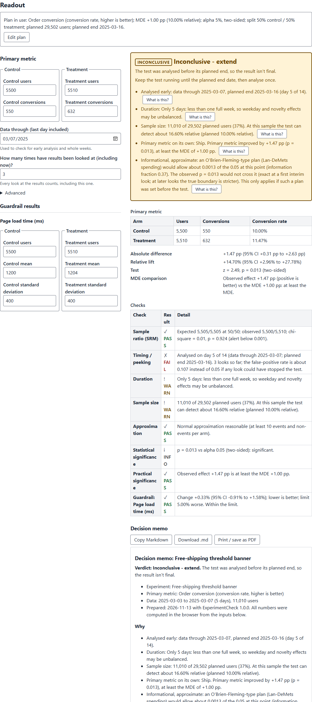
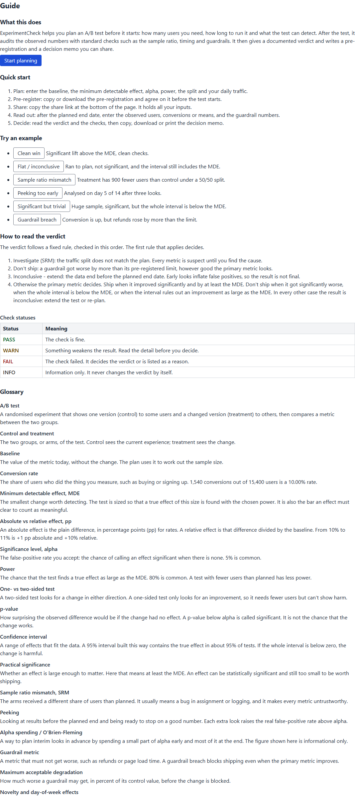

# ExperimentCheck

Plan, pre-register and audit A/B tests in your browser. No sign-up, no install, nothing uploaded.



*The built-in "Guardrail breach" example. All names and numbers are synthetic.*

## Live demo

Live demo: add the GitHub Pages link here after publishing.

## Contents

- [What it does and why](#what-it-does-and-why)
- [Features](#features)
- [Use it online](#use-it-online)
- [Use it offline](#use-it-offline)
- [Deploy your own copy on GitHub Pages](#deploy-your-own-copy-on-github-pages)
- [Walkthrough](#walkthrough)
- [How the verdict is decided](#how-the-verdict-is-decided)
- [The statistics, explained](#the-statistics-explained)
- [How the statistics are validated](#how-the-statistics-are-validated)
- [Limitations](#limitations)
- [Privacy](#privacy)
- [Accessibility](#accessibility)
- [FAQ](#faq)
- [For developers](#for-developers)
- [License](#license)

## What it does and why

Most experiment mistakes are cheap to prevent but expensive to discover late:

- Before launch, the test is too small to detect the effect anyone cares about, nobody wrote down a decision rule, and nobody named the guardrails (the metrics that must not get worse).
- At readout, someone checks the dashboard every day and stops when it turns green (peeking). Nobody checks whether the traffic split matches the plan (sample ratio mismatch, SRM). A significant lift that is too small to matter gets shipped. A guardrail regression is missed because it was not on the main chart.

People who make these calls often don't have a statistician on hand. ExperimentCheck joins planning, pre-registration, the readout audit and a plain-English decision memo in one page. It has two modes:

- **Plan**, before the test: how many users you need, how long to run, and what the test can detect. It writes a pre-registration you can share.
- **Readout**, after the test: it checks the observed numbers (sample ratio, timing, duration, sample size, approximations, significance, practical significance and guardrails), gives a documented verdict and writes a decision memo.

## Features

**Plan**

- Conversion (yes/no) or average-value metrics, higher or lower is better.
- Relative or absolute minimum detectable effect (MDE), alpha, power, one- or two-sided, any split.
- Users per arm, total users, days of traffic and a recommended whole-week duration with the planned end date.
- A sensitivity table and chart: what the test can detect after 1 to 12 weeks.
- Up to 10 guardrail metrics, each with a maximum acceptable degradation.



*The Plan tab for a synthetic checkout test: 14,751 users per arm, 14 days.*

**Readout and checks**

- Users and conversions per arm, or n, mean and standard deviation per arm.
- The last day of data, the number of looks so far and the results of each guardrail.
- Every check is shown as PASS, WARN, FAIL or INFO, in words and not only in colour.

**Verdicts**

- Ship, Don't ship, Inconclusive - extend, or Investigate (SRM), with the reasons in order and a next step.



*The synthetic "Clean win" example: significant, at least the MDE, all checks pass.*



*The synthetic "Peeking too early" example: analysed on day 5 of 14 after three looks.*

**Decision memo**

- A one-page memo with the verdict, the numbers, the checks, the pre-registered plan, the assumptions and the method. Copy it as Markdown, download it as a `.md` file, or print it or save it as PDF.

**Examples**

- Six synthetic examples, each with a known verdict: a clean win, a flat test, an SRM, peeking too early, a significant but trivial lift, and a guardrail breach. Loading one can be undone.

**Guide**

- A quick start, a glossary, how to read the verdict, the assumptions and limitations, and references. It opens first on your first visit.



*The Guide tab, as it opens on a first visit.*

**Shareable link**

- The whole state (plan and readout) is stored in the page address after `#s=`. Copy the link at the bottom of the page to share it.

**Privacy**

- Everything runs in your browser. See [Privacy](#privacy).

**Accessibility**

- Keyboard-operable tabs, visible focus, labelled fields, linked error messages and a table alternative for the chart. See [Accessibility](#accessibility).

## Use it online

1. Open the live demo (link above, once it is published).
2. Read the Guide first. It takes a few minutes and explains every number.
3. Try an example: pick one from "Load example" at the top, or use the buttons under "Try an example" in the Guide.

## Use it offline

1. Download the ZIP from the Releases page (or Code > Download ZIP).
2. Extract it (Windows: right-click > Extract All; macOS: double-click; Linux: your archive tool).
3. Double-click `index.html`.

- It works without internet.
- The share link is then a `file:///` link, which only works on the same computer.

## Deploy your own copy on GitHub Pages

1. Create a new repository on GitHub.
2. Upload the files: Add file > Upload files. GitHub accepts at most 100 files per upload, so upload in batches if needed. `.gitignore` and `.nojekyll` may be hidden by your file browser; if they are missing, create them with Add file > Create new file (`.nojekyll` stays empty).
3. Open Settings > Pages > Build and deployment. Set Source to "Deploy from a branch", Branch to `main` and the folder to `/ (root)`. Click Save.
4. Wait 1-2 minutes. The address is `https://<your-user-name>.github.io/<repository-name>/`.
5. Optional: set the repository's About > Website to that address.

## Walkthrough

Plan a test:

1. Open the Plan tab. Choose the metric type and direction, then enter the baseline, the MDE, alpha, power, sides, split and daily traffic.
2. Read the required users, the days of traffic and the recommended whole-week duration. Check the sensitivity table to see the trade-off between duration and detectable effect.
3. Add guardrails with their maximum acceptable degradation. Write the hypothesis and set the start date.

Pre-register and share:

4. Copy or download the pre-registration, and agree on it before the test starts.
5. Copy the share link into your team's document or ticket.

Run the readout:

6. After the planned end date, open the shared link (the plan is restored) or re-enter the plan.
7. Open the Readout tab. Enter the counts (or means and standard deviations), the "data through" date, the number of looks and the guardrail results.

Read the verdict and checks:

8. Read the verdict, its reasons and the next step. Fix any input errors shown next to the fields.
9. Read the checks table. Each row says what was checked and what was found.

Export the memo:

10. Copy, download or print the decision memo.

## How the verdict is decided

The verdict follows a fixed rule, checked in this order. The first rule that applies decides:

1. **Investigate (SRM)**: the sample ratio check fails. An SRM makes every metric suspect.
2. **Don't ship**: a guardrail got worse by more than its pre-registered limit, however good the primary metric is.
3. **Inconclusive - extend**: the data end before the planned end date. An early look can't give a final decision.
4. Otherwise the primary metric decides (the table below).

| Decisive reason | Summary |
|---|---|
| SRM | The traffic split does not match the plan, so the results can't be trusted yet. |
| Guardrail breach | A guardrail got worse by more than its pre-registered limit. |
| Early | The test was analysed before its planned end, so the result isn't final. |
| Ship, meaningful | The primary metric improved by at least the MDE, and the result is statistically significant. |
| Trivial | The improvement is real but smaller than the MDE. |
| Below the MDE | The improvement is significant, but it may be smaller than the MDE. |
| Borderline | The result sits right at the edge of significance. |
| Harm | The primary metric got significantly worse. |
| Flat | No meaningful effect: the data rule out an improvement as large as the MDE. |
| Underpowered | The test can't tell yet whether there is a meaningful effect. |
| No variance | The data show no variation. |

For the primary metric: a significant result with a positive effect ships when the effect is at least the MDE, is "trivial" (Don't ship) when the whole interval is below the MDE, and is otherwise inconclusive. A significant negative effect is "harm" (Don't ship). A non-significant result is "flat" (Don't ship) when the interval rules out the MDE, and "underpowered" (Inconclusive) otherwise. This is the statistical-versus-practical-significance grid described by Kohavi, Tang and Xu (2020), made explicit.

## The statistics, explained

All effects are "positive is good": when lower is better, the sign is flipped before the verdict logic runs.

**Sample size, conversion metrics.** Two-proportion test, normal approximation, without continuity correction (Fleiss, Levin and Paik 2003, ch. 4). With `k` = treatment users per control user:

```
p2 = target; pbar = (p1 + k*p2) / (1 + k); qbar = 1 - pbar
n1 = ( za*sqrt(pbar*qbar*(1 + 1/k)) + zb*sqrt(p1*(1-p1) + p2*(1-p2)/k) )^2 / (p2 - p1)^2
za = z(1 - alpha/sides), zb = z(power)
```

**Sample size, average-value metrics.** Two-sample means with equal standard deviations, normal approximation (Chow, Shao and Wang 2008, section 3.2). Approximation: it gives about 1-2 users per arm fewer than an exact t-based calculation at small n.

```
n1 = (1 + 1/k) * sd^2 * (za + zb)^2 / mde^2
```

Sample sizes are rounded up. The duration is rounded up to whole weeks, and at least 7 days, so every weekday is represented equally.

**Two-proportion z-test, Wald and Katz intervals.** The test uses the pooled standard error. The interval for the difference uses the unpooled (Wald) standard error. The interval for the relative lift uses the log risk ratio (Katz et al. 1978). All three are normal approximations (Agresti 2013).

```
z = (p2 - p1) / sqrt(pp*(1-pp)*(1/nc + 1/nt)),   pp = (xc + xt) / (nc + nt)
CI = diff +/- zc * sqrt(p1(1-p1)/nc + p2(1-p2)/nt)
relative CI = exp(ln(p2/p1) +/- zc * sqrt((1-p1)/xc + (1-p2)/xt)) - 1
```

**Welch's t-test.** For average-value metrics, with Welch-Satterthwaite degrees of freedom (Welch 1947; Satterthwaite 1946). The relative lift uses the delta method, which is an approximation.

```
se = sqrt(sdc^2/nc + sdt^2/nt);  t = (mt - mc) / se
df = (vc + vt)^2 / (vc^2/(nc-1) + vt^2/(nt-1)),   vc = sdc^2/nc, vt = sdt^2/nt
```

A one-sided test shows a two-sided 1 - 2·alpha interval (90% at alpha 5%), whose "better" bound equals the one-sided bound.

**SRM chi-square, and why 0.001.** A chi-square goodness-of-fit test of the observed users per arm against the planned split, with 1 degree of freedom. The alert fires below p = 0.001. A strict threshold like this is common practice for SRM alerts, because the check runs on every test and should rarely fire by chance (Kohavi, Tang and Xu 2020, ch. 21; Fabijan et al. 2019). It is a convention, not a value prescribed by either source. You can change it under Advanced.

**Peeking and the repeated-looks table.** Every look at the results that could have stopped the test raises the real false-positive rate. At alpha 5%, two-sided, the overall rate is about 0.083 after 2 looks, 0.107 after 3, 0.142 after 5, 0.193 after 10 and 0.374 after 100 (Armitage, McPherson and Rowe 1969; tabulated in Jennison and Turnbull 2000, table 1.1). The tool warns; it does not correct.

**O'Brien-Fleming-type spending (informational).** When the analysis is early or there were several looks, the tool shows how much alpha an O'Brien-Fleming-type plan (Lan-DeMets spending) would allow at the current information fraction `t`. This only applies if such a plan was set before the test, so it never changes the verdict. It is exact at a first interim look; at later looks the true boundary is stricter.

```
alphaSpent(t) = 2 - 2 * Phi( z(1 - alpha/2) / sqrt(t) )
```

**Practical significance.** The observed effect must be at least the pre-registered MDE. A significant effect below the MDE is not a reason to ship.

**Guardrail rule.** For each guardrail, the relative change and its two-sided 1 - alpha interval are computed (Katz for rates, delta method for means). It is breached when the point estimate is worse than the limit, and marked "At risk" when the interval reaches past the limit. The rule lies between two formal tests. It is stricter than a harm test (block only when the whole CI is beyond the limit) and less strict than a non-inferiority test (ship only when the whole CI is within the limit). It blocks on the point estimate and marks "At risk" when the CI reaches past the limit, because guardrails are usually underpowered and a non-inferiority requirement would block most tests.

**Numerical methods.** The normal distribution uses Hart's algorithm 5666 as published by West (2005), with double-precision accuracy and a directly computed upper tail. The normal quantile uses Acklam's algorithm (2003) with one Halley refinement step. The gamma function uses the Lanczos approximation (1964). The incomplete beta and gamma functions (for t and chi-square) use the continued fractions of Numerical Recipes (Press et al. 2007) with the modified Lentz method. The t quantile is found by bisection.

### References

- Fleiss, J. L., Levin, B. and Paik, M. C. (2003). *Statistical Methods for Rates and Proportions*, 3rd ed. Wiley. Chapter 4.
- Chow, S.-C., Shao, J. and Wang, H. (2008). *Sample Size Calculations in Clinical Research*, 2nd ed. Chapman & Hall/CRC. Section 3.2.
- Welch, B. L. (1947). The generalization of "Student's" problem when several different population variances are involved. *Biometrika* 34, 28-35. [doi:10.1093/biomet/34.1-2.28](https://doi.org/10.1093/biomet/34.1-2.28)
- Satterthwaite, F. E. (1946). An approximate distribution of estimates of variance components. *Biometrics Bulletin* 2, 110-114.
- Katz, D., Baptista, J., Azen, S. P. and Pike, M. C. (1978). Obtaining confidence intervals for the risk ratio in cohort studies. *Biometrics* 34, 469-474.
- Agresti, A. (2013). *Categorical Data Analysis*, 3rd ed. Wiley.
- Kohavi, R., Tang, D. and Xu, Y. (2020). *Trustworthy Online Controlled Experiments: A Practical Guide to A/B Testing*. Cambridge University Press. Chapters 2 and 21.
- Fabijan, A., Gupchup, J., Gupta, S., Omhover, J., Qin, W., Vermeer, L. and Dmitriev, P. (2019). Diagnosing sample ratio mismatch in online controlled experiments. *Proceedings of KDD 2019*. [doi:10.1145/3292500.3330722](https://doi.org/10.1145/3292500.3330722)
- Armitage, P., McPherson, C. K. and Rowe, B. C. (1969). Repeated significance tests on accumulating data. *Journal of the Royal Statistical Society A* 132, 235-244.
- Jennison, C. and Turnbull, B. W. (2000). *Group Sequential Methods with Applications to Clinical Trials*. Chapman & Hall/CRC. Table 1.1.
- O'Brien, P. C. and Fleming, T. R. (1979). A multiple testing procedure for clinical trials. *Biometrics* 35, 549-556.
- Lan, K. K. G. and DeMets, D. L. (1983). Discrete sequential boundaries for clinical trials. *Biometrika* 70, 659-663. [doi:10.1093/biomet/70.3.659](https://doi.org/10.1093/biomet/70.3.659)
- Hart, J. F. et al. (1968). *Computer Approximations*. Wiley. With West, G. (2005). Better approximations to cumulative normal functions. *Wilmott Magazine*, 70-76.
- Acklam, P. J. (2003). An algorithm for computing the inverse normal cumulative distribution function (published online).
- Lanczos, C. (1964). A precision approximation of the gamma function. *SIAM Journal on Numerical Analysis* B1, 86-96.
- Press, W. H., Teukolsky, S. A., Vetterling, W. T. and Flannery, B. P. (2007). *Numerical Recipes*, 3rd ed. Cambridge University Press.
- R Core Team. *R: A Language and Environment for Statistical Computing*. [r-project.org](https://www.r-project.org/)
- WAI-ARIA Authoring Practices Guide: Tabs pattern (W3C). [w3.org/WAI/ARIA/apg/patterns/tabs](https://www.w3.org/WAI/ARIA/apg/patterns/tabs/)

## How the statistics are validated

The statistics code is the same file in the browser and in the tests, so the tests check exactly what runs on the page.

- **Reference values.** The tests compare the code against 69 reference cases with stated tolerances. Each case names where its expected value comes from: the standard value for a named R call (R was not re-run; each such value was checked against an independent route such as numeric integration, a closed form or a round trip), a closed form, a numeric integration, a symmetry, identity or round trip, or the cited textbook formula evaluated directly. Most sample-size cases are the cited formula evaluated directly; they are not calculator or R checks.
- **Simulation checks.** Seeded Monte Carlo runs check that the intervals cover the true effect about as often as they should, that the z-test, Welch's test and the SRM check give false positives at about the nominal rate, and that a planned test reaches about its planned power.
- **Behaviour checks.** Each example gives its expected verdict and reasons, the decision memo matches [docs/sample-decision-memo.md](docs/sample-decision-memo.md), and the input validation, the share link and the page structure are tested.

Run them with `npm test`.

## Limitations

- Users are randomised independently, the analysis unit equals the randomisation unit, and each user is counted once.
- Normal approximations: z-test, Wald CI and Katz log CI (binary); delta-method relative CI (continuous); normal-approximation sample size. They are unreliable with small counts, and the tool warns.
- Welch's t-test assumes approximately normal sample means (central limit theorem). Heavily skewed metrics (revenue) may need more data or a transformation.
- One treatment vs one control. No correction for multiple metrics or multiple guardrails.
- No valid sequential testing: peeking is only warned about. The O'Brien-Fleming figure is informational.
- The verdict is a documented rule, not a substitute for judgement about costs, risks and strategy.
- Daily traffic is assumed constant. Returning users make the real duration longer.
- Not a substitute for a statistician on high-stakes decisions.

## Privacy

- No network requests (blocked by a Content Security Policy and checked by automated tests).
- No analytics and no cookies.
- localStorage holds only one flag: whether you have seen the Guide. No inputs are stored.
- The share link contains your inputs. Nothing leaves your browser unless you share the link or the memo yourself.

## Accessibility

- Tabs follow the WAI-ARIA tabs pattern: arrow keys, Home and End move between tabs.
- A skip link, exactly one main heading, and a heading at the start of each panel.
- Every field has a visible label and a hint. Errors appear next to the field, are linked to it, and are listed in a summary box whose entries move focus to the field.
- A clearly visible focus outline on every interactive element.
- Status is never shown by colour alone: checks show the words PASS, WARN, FAIL or INFO, and the verdict has a text badge. Text colours have at least 4.5:1 contrast.
- Click targets of at least 24 by 24 pixels, no animation, and a layout that reflows on narrow screens.
- The sensitivity chart has a table with the same numbers.

The target is WCAG 2.2 AA for what can be checked in code, and automated browser tests cover part of it. Full validation needs manual testing with assistive technology, such as a screen reader.

## FAQ

**Why does it say Inconclusive when my dashboard says significant?**
Usually because the test was analysed before its planned end, or because the interval still includes effects smaller than the MDE. A significant p-value alone is not a decision. The reasons under the verdict say which rule applied.

**Why whole weeks?**
Behaviour differs by weekday. Whole weeks give every weekday the same weight, and at least 7 days dampen novelty effects.

**Why an SRM threshold of 0.001?**
The SRM check runs on every test, so a strict threshold keeps false alarms rare. It is a common convention, not a value prescribed by the sources. You can change it under Advanced in the Readout tab.

**Can I stop as soon as it is significant?**
No. Stopping at the first significant look raises the real false-positive rate well above alpha. Plan the duration, run it, then analyse once.

**Can I use it for revenue per user?**
Yes, as an average-value metric with Welch's t-test. Revenue is often heavily skewed, so it may need more data or a transformation; the limitations above apply.

**Why does the sample size differ from another calculator?**
There are several formula variants (with or without continuity correction, normal or t quantiles, pooled or unpooled variance). This tool uses the Fleiss normal approximation without continuity correction, which is the same closed form that R's `power.prop.test` uses by default. For average-value metrics it uses the normal approximation, which gives about 1-2 users per arm fewer than an exact t-based calculation at small n.

**Is it Bayesian?**
No. It uses frequentist tests and confidence intervals.

**Does the share link store my data on a server?**
No. The inputs are encoded in the part of the address after `#`, which browsers do not send to servers. There is no server.

**Does it work on phones?**
Yes. The layout switches to one column on narrow screens, and wide tables scroll on their own.

**Can I add more than one treatment?**
Not yet. It compares one treatment with one control.

## For developers

File layout:

```
index.html          the page (markup, Guide text, Content Security Policy)
css/app.css         styles, including print styles for the memo
js/stats.js         normal, t and chi-square distributions, seeded random numbers
js/format.js        number formatting
js/validate.js      input parsing and validation
js/plan.js          sample size, duration and sensitivity
js/readout.js       tests, checks and the verdict
js/memo.js          pre-registration and decision memo
js/scenarios.js     the six synthetic examples
js/state.js         state, defaults and the share link
js/ui.js            the browser user interface
test/*.test.cjs     unit tests (Node's built-in test runner)
scripts/*.cjs       local server, browser smoke test, screenshots, packaging
docs/               PRD, build spec, sample memo, case study template and screenshots
```

Why classic scripts: Chromium-based browsers refuse ES module scripts on a `file://` page, which would break double-clicking `index.html`. Classic `<script defer>` files load from `file://` in all major browsers. Each file in `js/` uses a small wrapper, so the same file also loads with `require()` in Node and the tests run the exact code the page runs.

Requirements: Node 22 or newer, for the tooling only. The app itself needs only a browser.

Commands:

- `npm test`: the unit tests. It is the same as `node --test "test/**/*.test.cjs"`. Bare `node --test` would also pick up the copies of the tests under `dist/` once you have built a package.
- `node scripts/serve.cjs`: a local static server on 127.0.0.1.
- `node scripts/ui-smoke.cjs`: the browser smoke test in headless Edge and Firefox, from `file://` and over HTTP.
- `node scripts/capture-screenshots.cjs`: regenerates the screenshots in `docs/`.
- `node scripts/package-public.cjs --generic-only`: builds a clean copy and a ZIP under `dist/` and scans them for local paths and e-mail addresses.

There are zero dependencies: the app and the tooling use only the browser and Node's built-in modules.

Contributing: any change to the statistics needs tests, and new or changed formulas need reference values with a named source and a tolerance. Keep demo data synthetic.

## License

MIT, see [LICENSE](LICENSE).
